# Data Dealer

**The verified data supply chain for AI.** Data Dealer pays people for real data, verifies it, expands it into synthetic sets from those seeds, and sells it with signed provenance to autonomous AI agents. No humans in the loop.

> Private working repo. Created by Astra.

## Process flow

The full process flow diagram lives in [`docs/process-flow.mmd`](docs/process-flow.mmd), with rendered copies in [`docs/process-flow.svg`](docs/process-flow.svg) and [`docs/process-flow.png`](docs/process-flow.png).

## System parts ("The House")

| Part | Job |
| --- | --- |
| **The Source** | Contributor intake, automated ID check, consent |
| **The Assay** | 8-layer automated verification, grade A / B / C |
| **The Forge** | Seed-to-synthetic generation, every prompt logged |
| **Pit Boss** | Automated audit: 3-model judge panel + statistical sampling |
| **The Ledger** | Signs provenance manifests, public lookup |
| **The Deck** | Catalog of packaged, graded datasets ("Decks") |
| **The Table** | API + MCP server: search, tickets, purchases |
| **The Cage** | Credits, budget caps, payments, contributor payouts |
| **The Shoe** | Delivery: downloads + cloud shares |

## Deck package format

```
deck/
├── data/            # Parquet + JSONL
├── croissant.json   # MLCommons Croissant metadata
├── manifest.json    # signed provenance
├── DATASHEET.md
├── LICENSE.txt
└── sample/          # free 100-row sample
```

The process flow diagram is rendered from source below:

```mermaid
%%{init: {"theme": "neutral", "flowchart": {"subGraphTitleMargin": {"top": 6, "bottom": 18}, "nodeSpacing": 40, "rankSpacing": 45}}}%%
flowchart TD
    %% ===== Data Dealer — Process Flow Diagram =====
    %% Supply side (left) feeds verified data; demand side (right) buys it.

    subgraph SUPPLY["SUPPLY — paid contributors"]
        C1([Contributor signs up]) --> S1[The Source: automated ID check + 18+ verify<br/>Stripe Identity]
        S1 --> S2[E-sign contributor agreement<br/>ownership attestation + indemnity]
        S2 --> S3[Upload data dump / answer bounty ticket]
        S3 --> S4[(Raw vault<br/>S3 object lock — immutable original)]
    end

    subgraph ASSAY["THE ASSAY — verification"]
        A1[Origin checks<br/>web near-dup, reverse image, license scan]
        A2[File forensics<br/>export structure + metadata]
        A3[Personal-data scrub<br/>Presidio]
        A4[Quality checks<br/>schema, dedupe, LLM judge]
        A5{Pass all<br/>automated layers?}
        A1 --> A2 --> A3 --> A4 --> A5
    end

    S4 --> A1
    A5 -- no --> R1[Reject + notify contributor<br/>no payout]
    A5 -- yes --> SEED[(Verified seed store<br/>grade B)]

    subgraph DEMAND["DEMAND — AI agents (fully autonomous)"]
        D1([Agent connects via API / MCP]) --> D2{Existing Deck<br/>fits the need?}
        D2 -- yes --> D3[Search, read manifest,<br/>download free sample]
        D2 -- no --> T1[File ticket: request_dataset<br/>spec + budget + deadline]
        T1 --> T2[Instant quote + 20-row sample]
        T2 --> T3{Price within the account's<br/>pre-set spending policy?}
        T3 -- no --> X1([Auto-decline + counter-quote<br/>returned to agent])
    end

    T3 -- yes --> B1[Auto-post bounty to vetted experts]
    B1 --> C1

    subgraph FORGE["THE FORGE — seed-to-synthetic"]
        F1[Profile seeds<br/>schema, distributions, style]
        F2[Generate variations<br/>open-weight model, prompts logged]
        F3[Filter<br/>dedupe, fact-check, personal-data scan]
        F4[Score fidelity, diversity,<br/>privacy distance, usefulness]
        F1 --> F2 --> F3 --> F4
    end

    SEED --> F1
    F4 --> P1

    subgraph PITBOSS["PIT BOSS — automated audit"]
        P1[Judge panel: 3 independent models<br/>audit a random sample]
        P2{Error rate<br/>under 5%?}
        P1 --> P2
    end

    P2 -- no --> F2
    P2 -- yes --> L1

    subgraph LEDGER["THE LEDGER — provenance"]
        L1[Build manifest<br/>sources, consents, licenses,<br/>prompts, reviewers, hashes]
        L2[Sign manifest<br/>Ed25519 key in AWS KMS]
        L3[Publish to public lookup<br/>datadealer.ai/verify]
        L1 --> L2 --> L3
    end

    L3 --> K1

    subgraph DECK["THE DECK — packaging + catalog"]
        K1[Package Deck<br/>Parquet + croissant.json + manifest.json<br/>+ DATASHEET + LICENSE + sample]
        K2[(Catalog<br/>grade A / B / C, tier: Standard / Limited / Exclusive)]
        K1 --> K2
    end

    K2 --> D3
    D3 --> Q1

    subgraph CAGE["THE CAGE — payments"]
        Q1{Within agent's<br/>pre-set budget cap?}
        Q2[Auto-decline + notify owner<br/>no purchase made]
        Q3[Charge: credits / invoice /<br/>cloud marketplace / x402]
        Q1 -- no --> Q2
        Q1 -- yes --> Q3
    end

    Q3 --> SH1

    subgraph SHOE["THE SHOE — delivery"]
        SH1[Deliver: signed download or<br/>S3 / Snowflake / Hugging Face share]
        SH2[Record sale in Audit Vault]
        SH1 --> SH2
    end

    SH2 --> PAY[Royalty payouts to contributors<br/>Stripe Connect]
    PAY -.-> C1

    classDef decision fill:#fff4d6,stroke:#b8860b
    classDef store fill:#e6f0ff,stroke:#3b6fb6
    classDef stop fill:#fde8e8,stroke:#c0392b
    class A5,D2,T3,P2,Q1 decision
    class S4,SEED,K2 store
    class R1,X1,Q2 stop
```


