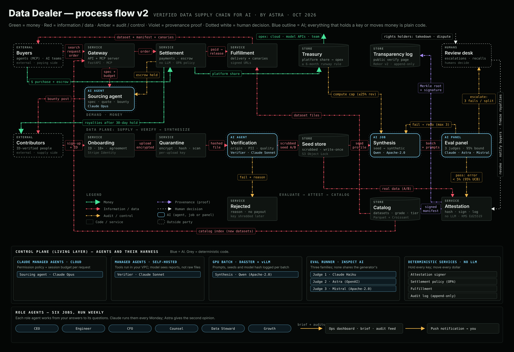

# Data Dealer

**The verified data supply chain for AI.** Data Dealer pays people for real data, verifies it, expands it into synthetic sets from those seeds, and sells it with signed provenance to AI teams and AI agents. Autonomous, with one human review desk for what a machine shouldn't decide.

> Private working repo. Created by Astra.

## Start here (v2, Oct 2026)

**Live ops dashboard (assignments, go-live gate, audits, Chip):** https://claude.ai/artifact/CzBXnEWyRjq5Tui7o3oRS8

Private: open it signed in to Astra's Claude account. The link never changes; every update is published to the same address. The source is in [`dashboard/`](dashboard/).

**On iPad or phone:** open the link above in Safari while signed in to Claude, then tap Share → **Add to Home Screen** for one-tap access. The page is built for touch: tap a part of the diagram to see it, tap **CHIP** (bottom right) for your goals, **GO →** to jump to where a goal applies, and **ANSWER** to record a decision. Answers save straight to the dashboard.

| What | Where |
| --- | --- |
| Plan v2: the flow, every change from v1, phases | [`docs/PLAN-v2.md`](docs/PLAN-v2.md) |
| Process flow chart v2 | [`diagrams/pipeline-v2.png`](diagrams/pipeline-v2.png) |
| Live ops dashboard (source) | [`dashboard/`](dashboard/) — build with `python3 dashboard/build.py` |
| Research (provenance, legal, market, synthetic data, agents, VCs, economics) | [`docs/research/`](docs/research/) |
| Guardrails and model roster | [`docs/guardrails.md`](docs/guardrails.md), [`docs/models.md`](docs/models.md) |
| Pitch narrative: mini deck → technical deck | [`docs/pitch/`](docs/pitch/) |
| Agents (pipeline + six role agents) and skills | [`.claude/agents/`](.claude/agents/), [`skills/`](skills/) |
| For any AI assistant working here | [`AGENTS.md`](AGENTS.md), [`handoffs/`](handoffs/) |
| Team: how the three subscriptions split the work | [`docs/team.md`](docs/team.md) |
| Weekly briefs | [`briefs/`](briefs/) |



## System parts

Named with literal engineering terms (see [`docs/naming.md`](docs/naming.md)). Data plane = the pipeline data moves through; control plane = the agents, policies and audits that run it.

| Part | Plane | Job |
| --- | --- | --- |
| **Gateway** | data | API + MCP server: search, requests, orders; buyer verification |
| **Sourcing agent** | control | Turns a request into a spec, quote and bounty (after Settlement holds the money) |
| **Onboarding** | data | Contributor ID + 18+ check, agreement, payout account |
| **Quarantine** | data | Per-file encryption, hashing, malware and child-safety scans |
| **Verification** (Verifier agent) | data | Origin, forensics, personal-data scrub, quality; grade A / B |
| **Seed store** | data | Scrubbed seed rows, write-once |
| **Synthesis** | data | Seed → synthetic generation, every prompt and model logged |
| **Eval panel** | control | Three judge models from three families; 95% upper error bound < 5% |
| **Attestation** | data | Signed provenance manifest, transparency-log entry |
| **Catalog** | data | Packaged, graded, tiered datasets |
| **Settlement** | data | Payments, escrow, budget caps, contributor payouts |
| **Fulfillment** | data | Delivery: signed downloads, cloud shares, canary rows |
| **Review desk** | control | Humans: disputes, takedowns, recalls, Exclusive deals |

The original v1 diagram (old names) is kept at `docs/process-flow.png`.

## Dataset package format

```
deck/
├── data/            # Parquet + JSONL
├── croissant.json   # MLCommons Croissant metadata
├── manifest.json    # signed provenance
├── DATASHEET.md
├── LICENSE.txt
└── sample/          # free 100-row sample
```


## Chip pet interface

*A pet app by Astra.*

Open [data-dealer-20261008.html](data-dealer-20261008.html) in a modern browser, or double-click Chip in Astra's PetOS. The nine original pet moods and manifest are included.

Limits: this browser interface does not install or start native programs. Where an existing web app is available, the Cage opens that app. Draft controls store their data in the current browser and do not imply connected services. Existing application instructions above still apply.

Version [v0.1.0-20261008-pets](https://github.com/findastra/data-dealer/tree/v0.1.0-20261008-pets). Added with OpenAI Codex (GPT-6), 2026-10-08.

Desktop appearance draft updated 2026-10-11: see [desktop details](desktop-pet-20261011.json). This changes the desktop pet, not application features.
